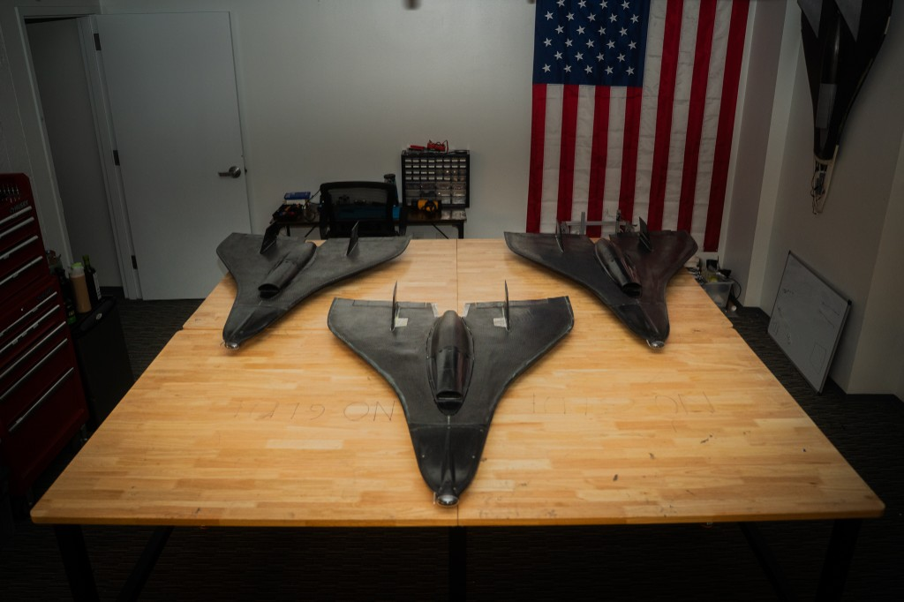

<p align="center">
  
</p>

<h1 align="center">Enrique Garcia</h1>

<p align="center">
  <strong>First-principles engineer</strong><br />
  <em>Aerospace &amp; autonomous systems</em>
</p>

<p align="center">
  <a href="https://enrique-gr.github.io/portfolio/">Live site</a>
  ·
  <a href="https://linkedin.com/in/enrique-gr">LinkedIn</a>
  ·
  <a href="https://github.com/enrique-gr">GitHub</a>
  ·
  <a href="resume.html">Resume</a>
</p>

<br />

<p align="center">
  
</p>

---

## Overview

This is my personal portfolio: a static site for **WashU Mechanical Engineering** work focused on vehicles, systems, and hardware.

The through-line is simple. Start from the model. Bring it up on hardware. Prove it under test.

---

## What you will find

| Section | What it is |
| :-- | :-- |
| **Featured** | Selected projects with role, outcome, and proof |
| **Mission timeline** | Where I am now, what is active, and what is next |
| **Skills** | Capabilities mapped to real coursework and builds |
| **Archive** | Personal and coursework projects in one place |
| **About / Interests** | Background, training, films, and reading |

Featured threads include **WashU VTOL**, **Design/Build/Fly**, defense and UAS research internships, and systems-focused personal builds.

---

## Open locally

No build step. Open the site like any static page:

```bash
# clone
git clone https://github.com/enrique-gr/portfolio.git
cd portfolio

# then open index.html in a browser
# or serve the folder if you prefer
python -m http.server 8000
```

Visit `http://localhost:8000` if you use the local server.

---

## How it is built

- **HTML · CSS · JavaScript** — no framework required to read or run
- **Tailwind CDN** for layout utilities
- Project pages stay readable and self-contained
- Assets live under `assets/` (brand, images, movies, videos)

---

## Contact

- LinkedIn: [linkedin.com/in/enrique-gr](https://linkedin.com/in/enrique-gr)
- GitHub: [github.com/enrique-gr](https://github.com/enrique-gr)
- Site: [enrique-gr.github.io/portfolio](https://enrique-gr.github.io/portfolio/)

---

<p align="center">
  <sub>Built to stay clear, fast, and easy to navigate.</sub>
</p>
