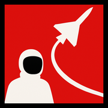

  

<h1 align="center">E.Garcia</h1>

  <code>First-principles engineer</code>

  Aerospace &amp; autonomous systems 
  <em>Dynamic. Model driven. Systems focused.</em>

  <a href="https://enrique-gr.github.io/portfolio/">Portfolio</a>
  &nbsp;·&nbsp;
  <a href="https://enrique-gr.github.io/portfolio/resume.html">Resume</a>
  &nbsp;·&nbsp;
  <a href="https://linkedin.com/in/enrique-gr">LinkedIn</a>
  &nbsp;·&nbsp;
  <a href="https://github.com/enrique-gr">GitHub</a>

---

### Personal portfolio

Built for recruiters and hiring teams. Open the site to see selected work, current roles, and proof — not a dump of every file in this repo.

I go from **model to vehicle**: systems thinking in simulation, then bring-up and validation on hardware.

---

### On the site

| | |
| :--- | :--- |
| **Featured** | Role, problem, outcome, and evidence |
| **Timeline** | Active work, recent experience, next targets |
| **Skills** | Capabilities tied to real builds |
| **Archive** | Deeper project pages |
| **About** | Background and how I think |

**Focus areas:** VTOL avionics · competition aircraft structures & test · UAS / sensor-fusion research · systems from model through hardware

---

### Start here

**[Open the portfolio →](https://enrique-gr.github.io/portfolio/)**

Then skim Featured and the mission timeline. Use the **[resume](https://enrique-gr.github.io/portfolio/resume.html)** when you need a one-pager.

---

  
    <a href="https://enrique-gr.github.io/portfolio/">enrique-gr.github.io/portfolio</a>
  

